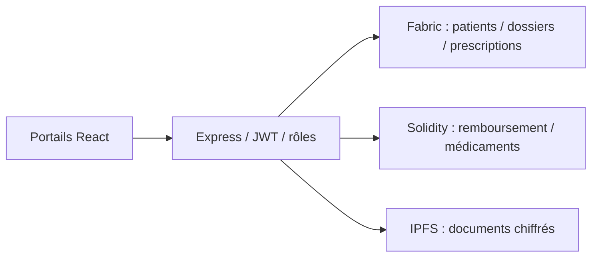

# MediChain+ — Santé numérique et blockchain hybride

Projet académique collectif EMSI, année 2025–2026. Une application web relie les parcours patient, médecin, pharmacie et assurance à un registre privé, des contrats EVM et un stockage de documents chiffrés.

**React · TypeScript · Express · Hyperledger Fabric · Solidity · Hardhat · ethers.js · IPFS**

## Fonctionnalités

- Gestion des patients, dossiers médicaux, historique et consentements.
- Création, vérification, dispensation et annulation de prescriptions.
- Cycle de remboursement : soumission, validation et paiement dans les contrats EVM.
- Traçabilité des lots de médicaments et de leurs changements de statut.
- Authentification par signature de portefeuille, JWT et contrôles de rôles dans l’API.
- Chiffrement AES-256-GCM des documents, références IPFS et vérification d’intégrité.
- Quatre portails métier et un mode de démonstration avec données fictives.



## Lancer la démonstration

Utiliser Node.js 24 et npm. À la racine :

```bash
npm ci
cp .env.example .env
node -e "console.log(require('crypto').randomBytes(32).toString('hex'))"
```

Placer la valeur générée dans `JWT_SECRET` de votre `.env`. Le mode `FABRIC_MODE=mock` sert la démonstration sur fichiers locaux ; `API_DEMO_ALLOW_ALL_ROLES=true` rend les parcours métier accessibles en laboratoire. Les données utilisées doivent être fictives. L’API écoute `127.0.0.1:3001`.

```bash
npm run api
```

Dans un second terminal :

```bash
cd frontend-react
npm ci
npm run dev -- --host 127.0.0.1
```

Ouvrir `http://127.0.0.1:5173`. Les fonctions EVM demandent un nœud Hardhat et un déploiement local :

```bash
npm run node -- --hostname 127.0.0.1
# Dans un autre terminal, à la racine :
npm run deploy:local
```

Reporter les deux adresses de contrats dans `.env`. Le compte de test du nœud local peut être sélectionné par `API_SIGNER_INDEX=0`, sans distribuer de clé privée dans le dépôt. Le service IPFS se configure avec `IPFS_API_URL` et `IPFS_GATEWAY_URL`. Les instructions du composant Fabric se trouvent dans [fabric-anas](fabric-anas/README.md) ; le mode réseau nécessite vos identités et votre infrastructure propres.

## Vérifications

Au 8 octobre 2026 : **47 tests API/contrats**, **24 tests Fabric**, compilation des deux contrats Solidity, compilation des trois chaincodes et du module IPFS, et build React réussis localement. Les tests Fabric vérifient notamment les rôles et les horodatages issus de la transaction. La [CI](.github/workflows/ci.yml) reproduit les tests et les builds.

```bash
npm test
npm run compile
cd fabric-anas && npm ci && npm test && npm run build
# Depuis frontend-react : npm run build
```

## Démonstration Docker

Après avoir créé `.env` avec votre secret JWT, `docker compose up --build --wait` démarre le nœud EVM local, déploie les contrats, lance IPFS et l’API, puis sert l’interface sur `http://127.0.0.1:8080`. Les adresses des contrats sont transmises automatiquement à l’API par un volume de déploiement ; les ports publiés restent accessibles sur le poste local. `docker compose down -v` réinitialise les données de cette démonstration.

## Rapport et équipe

- [Rapport final — 36 pages](docs/Rapport_MediChainPlus.pdf)
- [Cahier des charges](docs/Cahier_des_charges_MediChainPlus.pdf)

Équipe : **Ilyas Ajelyan, Anas El Karkouri, Omar Babba, Omar Gaga et Amin Er-Rebbat**. Encadrement : **Hassan Badir**, EMSI. Le rapport décrit la répartition du travail : contrats et coordination, Fabric/IPFS, interface React, API/identités et DevOps/tests.

Ce dépôt rassemble la version complète fournie dans `MediChainPlus.zip` et son composant Fabric/IPFS. [Autre réalisation MediChain+ de l’équipe](https://github.com/ajelyanilyas/Medichain-plus).
